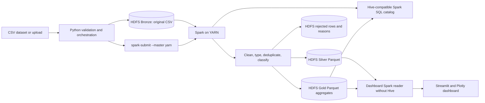

# From Raw Data to Insight

An end-to-end Big Data Analytics Pipeline for fictional e-commerce transactions. The project validates CSV input, stores raw files in HDFS Bronze, processes records with Spark on YARN, writes cleaned Silver and analytical Gold Parquet datasets, registers Hive-compatible Spark SQL tables, and presents results in a six-page Streamlit dashboard.

This repository is an educational and research demonstration on a single-node WSL2 cluster. It shows a working pipeline and its operational behavior; it is not a production deployment or a multi-node performance study. All dataset names, customers, transactions, and INR amounts are synthetic.

## Objectives

- Demonstrate ingestion, data validation, distributed processing, layered storage, SQL analytics, and visualization in one reproducible project.
- Preserve invalid input with rejection reasons rather than silently discarding it.
- Record data quality, run state, output locations, and measured timings.
- Document the limits and operational trade-offs of a resource-constrained local cluster.

## Features

- CSV header/schema validation and HDFS Bronze ingestion.
- Spark DataFrame cleaning, deterministic deduplication, and rejected-row quarantine on YARN.
- Silver transactions and seven Gold Parquet aggregates.
- Persistent Hive-compatible catalog backed by Spark's bundled Hive client and embedded Derby.
- Spark SQL verification of delivered revenue against the Spark aggregate.
- Streamlit pages for Overview, Data Explorer, Pipeline Monitor, Sales Analytics, Customer Analytics, and Data Quality.
- Manual deterministic benchmark runs, HDFS/YARN status checks, and unit/local Spark tests.

## Architecture



Pipeline and benchmark catalog writers serialize access to embedded Derby with an OS-managed lock. Dashboard analytics read immutable HDFS paths from the latest successful run without opening a Hive client. See [architecture](docs/architecture.md) for the detailed flow and storage layout.

## Workflow

1. Validate the CSV schema before upload.
2. Copy the original CSV to a unique HDFS Bronze run path.
3. Submit `src/processing/spark_engine.py` to YARN with `--master yarn`.
4. Clean and deduplicate records; write valid Silver and rejected rows with reasons.
5. Produce seven Gold aggregates and quality metadata as Parquet.
6. Register the outputs in the Hive-compatible catalog and compare delivered revenue from Spark SQL with the Spark aggregate.
7. Check YARN completion and HDFS output paths before publishing the run as current.
8. Explore the latest successful immutable outputs in Streamlit.

## Technology

| Component | Version or selection | Role |
|---|---|---|
| OS | Ubuntu 22.04 under WSL2 (verified environment) | Single-node development runtime |
| Java | OpenJDK 17 | Hadoop and Spark JVM |
| Python | Python 3.10 (verified environment) | Orchestration, dashboard, tests |
| Hadoop | 3.5.0 | HDFS and YARN |
| Spark / PySpark | 4.2.1 | DataFrames, SQL, YARN processing |
| Hive support | Spark bundled Hive 2.3.10 with embedded Derby | Persistent catalog; no separate metastore/HS2 service |
| Python packages | Pandas, PyArrow, Plotly, Streamlit, Pytest | Data handling, charts, UI, testing; see `requirements.txt` |

The selected runtime and limitations are documented in [technology stack](docs/technology_stack.md) and [infrastructure verification](docs/infrastructure_verification.md).

## Repository layout

```text
.
├── app.py                         # Streamlit entry point
├── config/                        # Hadoop, Spark, Hive, and project settings
├── dashboard/                     # Six dashboard pages and shared UI components
├── data/
│   ├── raw/                       # 50k-row synthetic demonstration CSV
│   └── sample/                    # Clean, corrupted, and edge-case fixtures
├── docs/                          # Architecture, setup, research, and operations docs
├── hive/sql/                      # Reference Hive-compatible SQL examples
├── scripts/                       # Setup, lifecycle, verification, and run commands
├── src/                           # Ingestion, processing, analytics, pipeline, storage
├── tests/                         # Pytest and local Spark tests
├── utils/                         # Deterministic synthetic data generator and helpers
├── ASSET_MANIFEST.json            # Starter asset checksums
├── requirements.txt               # Python dependencies
└── .streamlit/config.toml          # Non-secret dashboard theme
```

`.runtime/`, `.venv/`, Python caches, secrets, and generated `data/benchmark/` outputs are local-only and ignored by Git. The generated benchmark files currently in this workspace are preserved locally but are not required source datasets.

## Requirements

- Windows 10/11 with WSL2, or a compatible Ubuntu 22.04 Linux environment. The recorded verification used WSL2 Ubuntu 22.04.5 and about 8 GiB RAM.
- OpenJDK 17, Python 3.10, `python3-venv`, `curl`, `tar`, and `sha512sum`.
- About 1 GB of temporary download space for the Hadoop and PySpark source archives, plus additional space for HDFS data and runtime files.
- The Hadoop/YARN single-node configuration allocates 3 GiB and 2 vcores to YARN; leave memory for WSL, HDFS, the Spark driver, and Streamlit.

Hadoop, Spark, HDFS, YARN, and Hive support are external runtime components; Python requirements alone do not install the Hadoop daemons.

## WSL setup

Run these commands from the cloned repository in WSL. If `.venv` already exists, keep it and skip the creation command. `.venv` is ignored and this project setup does not require replacing an existing environment.

```bash
sudo apt update
sudo apt install -y openjdk-17-jdk python3.10 python3.10-venv python3-pip curl tar
export JAVA_HOME=/usr/lib/jvm/java-17-openjdk-amd64

python3.10 -m venv .venv       # only when .venv does not already exist
source .venv/bin/activate
python -m pip install -r requirements.txt
```

The checked-in `scripts/setup_bigdata.sh` expects these release archives under the ignored `.runtime/archives/` directory. It verifies the Hadoop SHA-512 file, installs the local PySpark source archive, extracts Hadoop, and copies project configuration. Download the exact versions used by this project:

```bash
mkdir -p .runtime/archives
curl -fL 'https://archive.apache.org/dist/hadoop/common/hadoop-3.5.0/hadoop-3.5.0.tar.gz' \
  -o .runtime/archives/hadoop-3.5.0.tar.gz
curl -fL 'https://archive.apache.org/dist/hadoop/common/hadoop-3.5.0/hadoop-3.5.0.tar.gz.sha512' \
  -o .runtime/archives/hadoop-3.5.0.tar.gz.sha512
python -m pip download --no-deps --no-binary=:all: --dest .runtime/archives pyspark==4.2.1
```

Then prepare the local runtime and start/verify HDFS and YARN:

```bash
./scripts/setup_bigdata.sh
./scripts/start_bigdata.sh
./scripts/verify_bigdata.sh
```

### First-time HDFS initialization only

The NameNode directory is `.runtime/data/dfs/name`. Inspect this exact directory before any initial format:

```bash
find .runtime/data/dfs/name -mindepth 1 -maxdepth 1 -print
```

Only for a new cluster with no existing NameNode metadata, use the guarded initializer once:

```bash
./scripts/initialize_hdfs.sh --confirm-first-format
./scripts/start_bigdata.sh
```

If the directory contains `current/` or other metadata, do not run the initializer. Normal setup and startup do not format HDFS. Preserve `.runtime/data/dfs/name` and `.runtime/data/dfs/data` when restarting the same namespace.

## Run the pipeline

From the repository root with HDFS and YARN running:

```bash
./scripts/run_pipeline.sh data/raw/ecommerce_transactions_50000.csv
```

The CLI accepts one CSV path. Each run uses a unique HDFS path and records events, Spark logs, and results under ignored `.runtime/logs/pipeline_runs/`. A successful run advances the latest-run pointer only after YARN, SQL, and output checks pass. For the dashboard workflow, start the UI and use **Pipeline Monitor → Run Pipeline**.

## Launch the dashboard

```bash
./scripts/run_dashboard.sh
```

Open the local URL printed by Streamlit (normally `http://localhost:8501`). The pages are Overview, Data Explorer, Pipeline Monitor, Sales Analytics, Customer Analytics, and Data Quality. The dashboard reads the most recent successful HDFS outputs; HDFS and YARN should be running first.

## Benchmarking

Run one supported deterministic synthetic size at a time:

```bash
./scripts/run_benchmark.sh 10000
```

Supported sizes are 10,000, 50,000, 100,000, 250,000, and 500,000 rows. Benchmarking is manual and may take several minutes. Run results are recorded under `.runtime/logs/`, HDFS metadata, and the Hive-compatible catalog. Generated input files under `data/benchmark/` are ignored by Git.

## Tests

Run from the project root:

```bash
source scripts/bigdata_env.sh
.venv/bin/pytest -q
```

The tests cover ingestion validation, synthetic generation, cleaning and rejection rules, and Gold calculations using local Spark. They are not a replacement for HDFS/YARN integration checks. See [testing and verification](docs/testing.md).

## Dashboard screenshots

Screenshots are not included yet. Add sanitized captures before publication; do not include local paths, uploaded customer data, or runtime logs.

| Page | Screenshot placeholder |
|---|---|
| Overview | `docs/screenshots/overview.png` |
| Data Explorer | `docs/screenshots/data-explorer.png` |
| Pipeline Monitor | `docs/screenshots/pipeline-monitor.png` |
| Sales Analytics | `docs/screenshots/sales-analytics.png` |
| Customer Analytics | `docs/screenshots/customer-analytics.png` |
| Data Quality | `docs/screenshots/data-quality.png` |

## Datasets and results

The project documents its transaction files as fictional synthetic data; they do not represent real customers or sales. The raw demonstration CSV has 50,000 source rows plus injected duplicate rows; the sample directory contains a clean fixture, a corrupted fixture, and edge cases. The raw CSV is checksum-verified by the asset manifest, but its source seed is not recorded and it does not byte-match the current generator's default output. Confirm its synthetic provenance before public release. Dataset fields and rules are in the [data dictionary](docs/data_dictionary.md); recommended uses are in the [dataset profile](docs/dataset_profile.md).

The recorded 50,000-row run completed successfully on YARN with 48,357 valid Silver records, 1,893 rejected records, 250 duplicate IDs removed, and delivered revenue of ₹791,026,472.09. Hive-compatible Spark SQL returned the same delivered-revenue total. The recorded 10,000-row benchmark completed in 233.311 seconds end to end at 42.86 rows/second. These are single-run observations, not averages, controlled comparisons, or production performance claims; details and timing breakdowns are in [research observations](docs/research_observations.md).

## Research and academic context

The project is a reproducible systems demonstration of an end-to-end batch analytics workflow and its operational boundaries. The local single-node results illustrate data quality handling, catalog use, and measured execution phases. A defensible comparative performance study would require repeated controlled trials, a stated warm-up policy, equivalent workloads, and suitable multi-node infrastructure. The repository does not make unsupported literature or scaling claims.

## Known limitations

- Single-node pseudo-distributed Hadoop/YARN; no high availability or multi-node scaling evidence.
- Embedded Derby metastore, with serialized writers; no standalone Hive Metastore service, HiveServer2, or Beeline endpoint.
- Synthetic batch input only; no production source, streaming ingestion, authentication, or deployment hardening.
- Timings are sensitive to JVM startup, metastore initialization, WSL I/O, and run order.

See [challenges and solutions](docs/challenges_and_solutions.md) and [infrastructure verification](docs/infrastructure_verification.md).

## Documentation

- [Setup and operations](docs/setup_guide.md)
- [Pipeline workflow](docs/workflow.md)
- [Architecture](docs/architecture.md)
- [Troubleshooting](docs/troubleshooting.md)
- [Data dictionary](docs/data_dictionary.md) and [dataset profile](docs/dataset_profile.md)
- [Research observations](docs/research_observations.md)
- [Testing record](docs/testing.md)

## Future improvements

- Add repeatable multi-trial benchmarks and publish full experiment methodology.
- Add a separately managed metastore service if deployment needs justify its resource cost.
- Add configurable external input sources, authentication, and deployment automation.
- Capture sanitized dashboard screenshots and expand integration tests.

## Contributors and license

- Author: **[Add author name]**
- Contributors: **[Add contributor names, if applicable]**
- Contact or profile: **[Add a public contact or profile, if desired]**

No license has been selected. Choose and add a license before granting public reuse rights; this repository does not choose one on the author's behalf.
