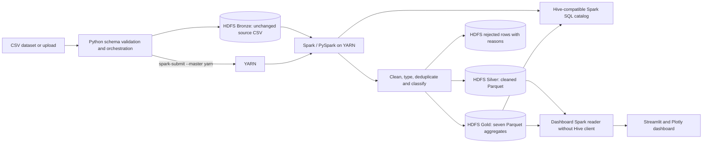
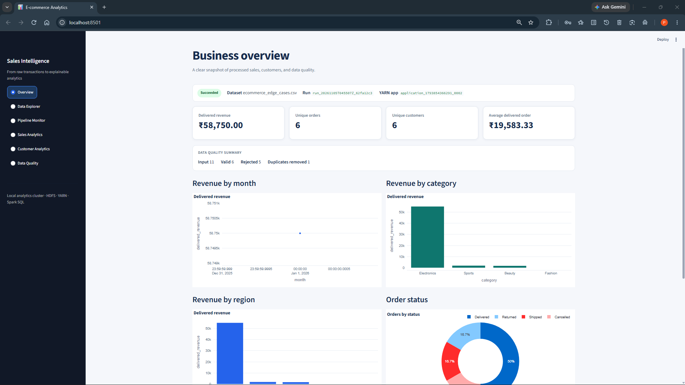
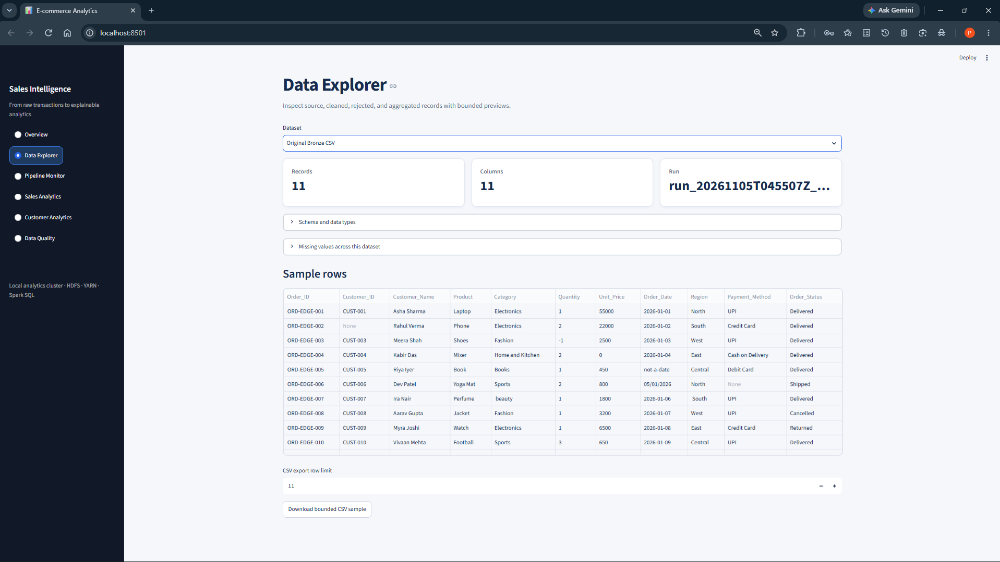
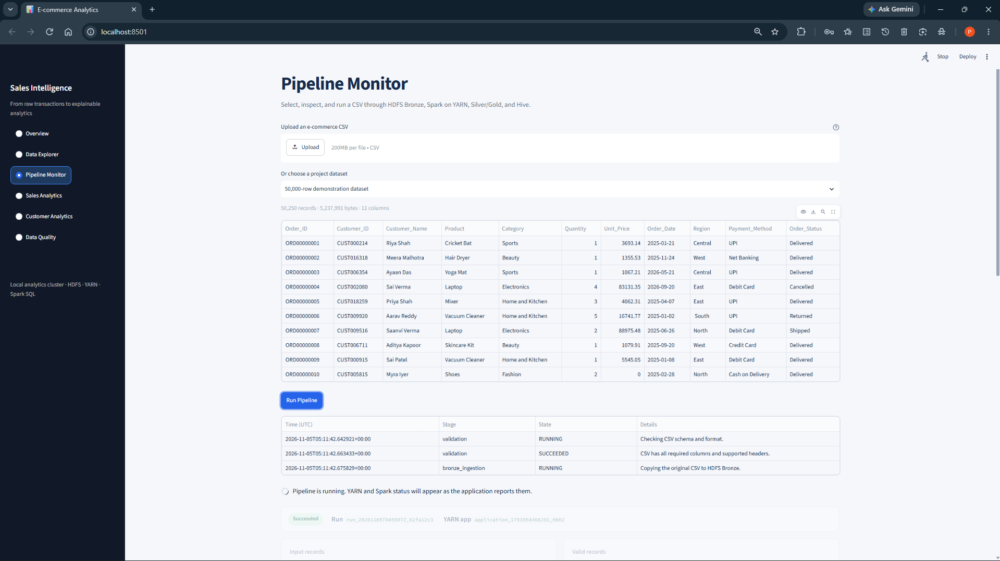
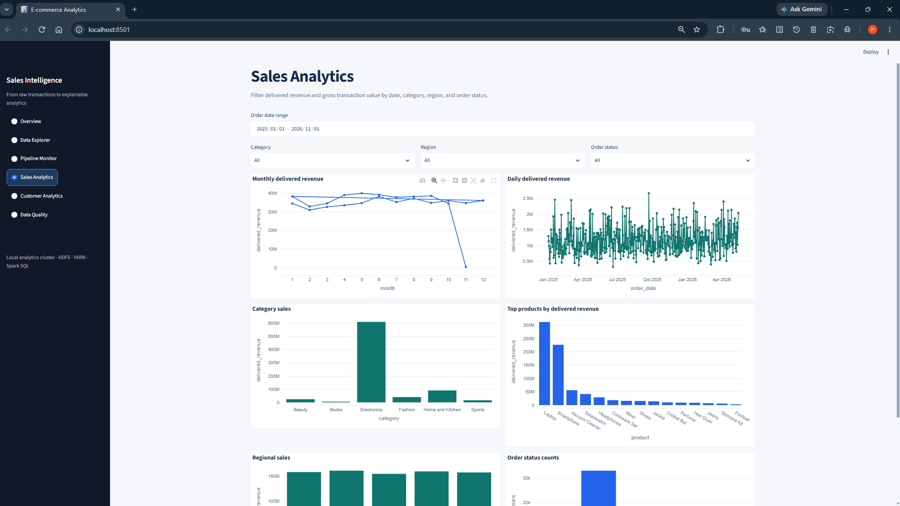
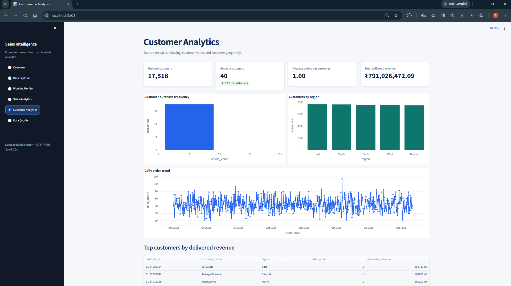
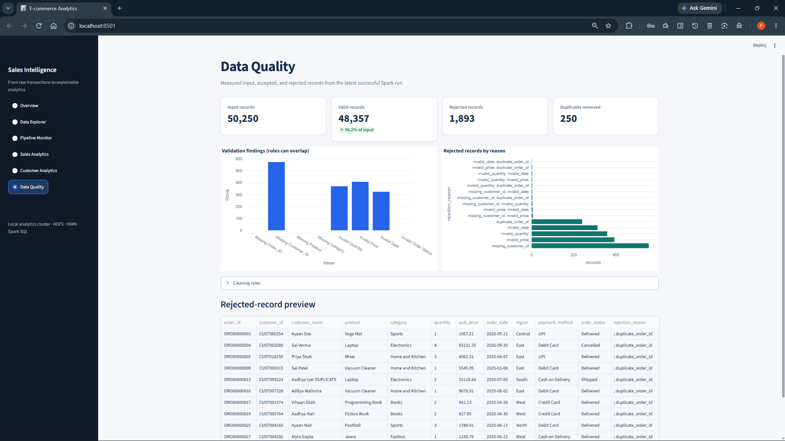

# Big Data Analytics Pipeline

An end-to-end batch analytics project for fictional e-commerce transactions. It validates CSV input, stores immutable source files in HDFS Bronze, processes records with Spark on YARN, writes cleaned Silver and analytical Gold Parquet datasets, registers Hive-compatible Spark SQL tables, and presents results in a six-page Streamlit dashboard.

This is an educational and research demonstration on a single-node WSL2 cluster, not a production deployment or a multi-node performance study. All dataset names, customers, transactions, and INR amounts are synthetic.

[](https://hadoop.apache.org/docs/r3.5.0/)
[](https://spark.apache.org/docs/4.2.1/)
[](https://openjdk.org/)
[](https://www.python.org/)
[](https://streamlit.io/)

## Project overview

The pipeline demonstrates ingestion, data validation, distributed processing, layered storage, SQL analytics, and visualization in one reproducible project. Invalid input is retained with rejection reasons rather than silently discarded. Run state, data quality, output locations, and measured timings are recorded so the workflow can be inspected end to end.

### Architecture



Catalog writers in the pipeline and benchmark serialize access to the embedded Derby catalog with an OS-managed lock. Dashboard analytics read immutable HDFS paths from the latest successful run without opening a Hive client. See [architecture](docs/architecture.md) for the detailed flow and storage layout.

### Bronze → Silver → Gold data flow

1. **Bronze:** Python validates the CSV header/schema and copies the original file to a unique HDFS run path. The source is retained unchanged.
2. **Silver:** Spark reads Bronze on YARN, applies explicit type and quality rules, normalizes and deterministically deduplicates valid transactions, then writes partitioned Parquet. Invalid rows are written separately with their original values and rejection reasons.
3. **Gold:** Spark creates seven analytical Parquet aggregates for monthly sales, daily sales, category, region, product, customer, and order status. It registers the Parquet outputs in the Hive-compatible Spark SQL catalog and checks that SQL delivered revenue matches the Spark aggregate.
4. **Explore:** Once YARN and HDFS output checks pass, the orchestrator publishes the successful run. Streamlit reads that run's immutable Silver and Gold HDFS paths for charts, bounded previews, data quality, and pipeline status.

## Dashboard preview

The dashboard has six pages for exploring the latest successful pipeline run.

### Overview



### Data Explorer



### Pipeline Monitor



### Sales Analytics



### Customer Analytics



### Data Quality



## Technology stack

| Component | Version or selection | Role |
|---|---|---|
| OS | Ubuntu 22.04 under WSL2 (verified environment) | Single-node development runtime |
| Java | OpenJDK 17 | Hadoop and Spark JVM |
| Python | Python 3.10 (verified environment) | Orchestration, dashboard, tests |
| Hadoop | 3.5.0 | HDFS storage and YARN resource management |
| Spark / PySpark | 4.2.1 | DataFrames, SQL, YARN processing |
| Hive support | Spark bundled Hive 2.3.10 with embedded Derby | Persistent catalog; no separate metastore or HiveServer2 service |
| Python packages | Pandas, PyArrow, Plotly, Streamlit, Pytest | Data handling, charts, UI, testing; see `requirements.txt` |

The selected runtime and constraints are documented in [technology stack](docs/technology_stack.md) and [infrastructure verification](docs/infrastructure_verification.md).

## Repository structure

```text
.
├── app.py                         # Streamlit entry point
├── config/                        # Hadoop, Spark, Hive, and project settings
├── dashboard/                     # Six dashboard pages and shared UI components
├── data/
│   ├── raw/                       # 50k-row synthetic demonstration CSV
│   └── sample/                    # Clean, corrupted, and edge-case fixtures
├── docs/                          # Setup, architecture, research, operations, screenshots
│   └── screenshots/               # Dashboard preview images
├── hive/sql/                      # Reference Hive-compatible SQL examples
├── scripts/                       # Setup, lifecycle, verification, and run commands
├── src/                           # Ingestion, processing, analytics, pipeline, storage
├── tests/                         # Pytest and local Spark tests
├── utils/                         # Deterministic synthetic data generator and helpers
├── ASSET_MANIFEST.json            # Starter asset checksums
├── requirements.txt               # Python dependencies
└── .streamlit/config.toml          # Non-secret dashboard theme
```

`.runtime/`, `.venv/`, Python caches, secrets, and generated `data/benchmark/` outputs are local-only and ignored by Git. The generated benchmark files currently in the workspace are preserved locally but are not required source datasets.

## Setup

### Requirements

- Windows 10/11 with WSL2, or a compatible Ubuntu 22.04 Linux environment. The recorded verification used WSL2 Ubuntu 22.04.5 and about 8 GiB RAM.
- OpenJDK 17, Python 3.10, `python3-venv`, `curl`, `tar`, and `sha512sum`.
- About 1 GB of temporary download space for Hadoop and PySpark source archives, plus additional space for HDFS data and runtime files.
- The Hadoop/YARN single-node configuration allocates 3 GiB and 2 vcores to YARN; leave memory for WSL, HDFS, the Spark driver, and Streamlit.

Hadoop, Spark, HDFS, YARN, and Hive support are external runtime components; installing Python requirements alone does not install the Hadoop daemons.

### Install Python dependencies

Run from the cloned repository in WSL. If `.venv` already exists, keep it and skip the creation command. This setup does not require replacing an existing environment.

```bash
sudo apt update
sudo apt install -y openjdk-17-jdk python3.10 python3.10-venv python3-pip curl tar
export JAVA_HOME=/usr/lib/jvm/java-17-openjdk-amd64

python3.10 -m venv .venv       # only when .venv does not already exist
source .venv/bin/activate
python -m pip install -r requirements.txt
```

### Prepare the Hadoop and Spark runtime

`scripts/setup_bigdata.sh` expects release archives under the ignored `.runtime/archives/` directory. It verifies the Hadoop SHA-512 file, installs the local PySpark source archive, extracts Hadoop, and copies project configuration. Download the exact versions used by the project:

```bash
mkdir -p .runtime/archives
curl -fL 'https://archive.apache.org/dist/hadoop/common/hadoop-3.5.0/hadoop-3.5.0.tar.gz' \
  -o .runtime/archives/hadoop-3.5.0.tar.gz
curl -fL 'https://archive.apache.org/dist/hadoop/common/hadoop-3.5.0/hadoop-3.5.0.tar.gz.sha512' \
  -o .runtime/archives/hadoop-3.5.0.tar.gz.sha512
python -m pip download --no-deps --no-binary=:all: --dest .runtime/archives pyspark==4.2.1

./scripts/setup_bigdata.sh
./scripts/start_bigdata.sh
./scripts/verify_bigdata.sh
```

### Initialize HDFS once on a new cluster

The NameNode directory is `.runtime/data/dfs/name`. Inspect this exact directory before any initial format:

```bash
find .runtime/data/dfs/name -mindepth 1 -maxdepth 1 -print
```

Only for a new cluster with no existing NameNode metadata, use the guarded initializer once, then start the services:

```bash
./scripts/initialize_hdfs.sh --confirm-first-format
./scripts/start_bigdata.sh
```

If the directory contains `current/` or other metadata, do not run the initializer. Normal setup and startup do not format HDFS. Preserve `.runtime/data/dfs/name` and `.runtime/data/dfs/data` when restarting the same namespace.

## Run the pipeline and dashboard

With HDFS and YARN running, submit the included synthetic dataset:

```bash
./scripts/run_pipeline.sh data/raw/ecommerce_transactions_50000.csv
```

The CLI accepts one CSV path. Each run uses a unique HDFS path and records events, Spark logs, and results under ignored `.runtime/logs/pipeline_runs/`. A successful run advances the latest-run pointer only after YARN, SQL, and output checks pass. From the dashboard, use **Pipeline Monitor → Run Pipeline** to select a fixture, upload, or generated input.

Start the Streamlit dashboard in a separate terminal:

```bash
./scripts/run_dashboard.sh
```

Open the local URL printed by Streamlit (normally `http://localhost:8501`). Pages are Overview, Data Explorer, Pipeline Monitor, Sales Analytics, Customer Analytics, and Data Quality. The dashboard reads the most recent successful HDFS outputs; HDFS and YARN should be running first.

## Testing and benchmarks

### Tests

Run from the project root:

```bash
source scripts/bigdata_env.sh
.venv/bin/pytest -q
```

The tests cover ingestion validation, synthetic generation, cleaning and rejection rules, and Gold calculations using local Spark. They are not a replacement for HDFS/YARN integration checks. See [testing and verification](docs/testing.md).

### Benchmarking

Run one supported deterministic synthetic size at a time:

```bash
./scripts/run_benchmark.sh 10000
```

Supported sizes are 10,000, 50,000, 100,000, 250,000, and 500,000 rows. Benchmarking is manual and may take several minutes. Run results are recorded under `.runtime/logs/`, HDFS metadata, and the Hive-compatible catalog. Generated input files under `data/benchmark/` are ignored by Git.

### Recorded observations

The recorded 50,000-row run completed successfully on YARN with 48,357 valid Silver records, 1,893 rejected records, 250 duplicate IDs removed, and delivered revenue of ₹791,026,472.09. Hive-compatible Spark SQL returned the same delivered-revenue total.

The recorded 10,000-row benchmark completed in 233.311 seconds end to end at 42.86 rows/second. These are single-run observations, not averages, controlled comparisons, or production performance claims. See [research observations](docs/research_observations.md) for the timing breakdown and measurement context.

## Data and research context

The transaction files are fictional synthetic data; they do not represent real customers or sales. The raw demonstration CSV has 50,000 source rows plus injected duplicate rows. The sample directory contains a clean fixture, a corrupted fixture, and edge cases. The raw CSV is checksum-verified by the asset manifest, but its source seed is not recorded and it does not byte-match the current generator's default output. Confirm its synthetic provenance before public release. Fields and rules are in the [data dictionary](docs/data_dictionary.md); recommended uses are in the [dataset profile](docs/dataset_profile.md).

This project is a reproducible systems demonstration of an end-to-end batch analytics workflow and its operational boundaries. The local single-node results illustrate data quality handling, catalog use, and measured execution phases. A defensible comparative performance study would need repeated controlled trials, a stated warm-up policy, equivalent workloads, and suitable multi-node infrastructure. No unsupported literature or scaling claims are made.

## Known limitations and future improvements

- Single-node pseudo-distributed Hadoop/YARN; no high availability or multi-node scaling evidence.
- Embedded Derby metastore with serialized writers; no standalone Hive Metastore service, HiveServer2, or Beeline endpoint.
- Synthetic batch input only; no production source, streaming ingestion, authentication, or deployment hardening.
- Timings are sensitive to JVM startup, metastore initialization, WSL I/O, and run order.

Potential next steps include repeatable multi-trial benchmarks with a documented methodology, a separately managed metastore if deployment needs justify its resource cost, configurable external input sources, authentication and deployment automation, and expanded integration tests. See [challenges and solutions](docs/challenges_and_solutions.md) and [infrastructure verification](docs/infrastructure_verification.md) for more operational context.

## Documentation

- [Setup and operations](docs/setup_guide.md)
- [Pipeline workflow](docs/workflow.md)
- [Architecture](docs/architecture.md)
- [Technology stack](docs/technology_stack.md)
- [Troubleshooting](docs/troubleshooting.md)
- [Data dictionary](docs/data_dictionary.md) and [dataset profile](docs/dataset_profile.md)
- [Research observations](docs/research_observations.md)
- [Testing record](docs/testing.md)
- [Infrastructure verification](docs/infrastructure_verification.md)

## Author

**Piyush Sachdeva**
