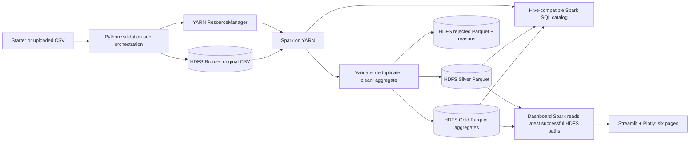
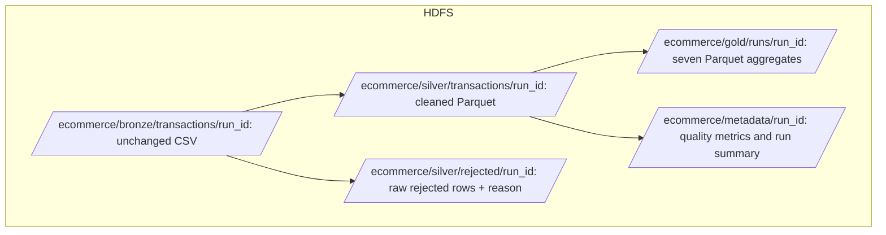
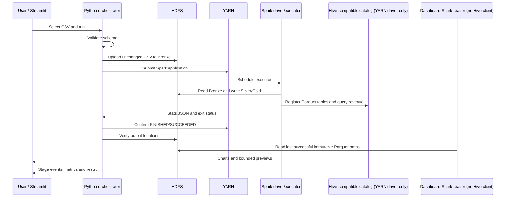

# Architecture

## System view

## Storage layers

## YARN and Spark execution

The Python orchestrator validates a CSV, copies it to a unique Bronze location and starts `spark-submit --master yarn --deploy-mode client`. The client driver runs in the invoking process; YARN schedules the executor on the single NodeManager. Spark reads Bronze through Hadoop filesystem support, computes typed records and rejects with DataFrame transformations, writes Parquet outputs, registers tables and checks a delivered revenue SQL result against the Spark aggregate. The orchestrator checks the YARN final state and expected HDFS paths before marking the run successful.

The YARN driver is the only application process that opens the embedded Derby-backed Hive catalog. Pipeline and benchmark catalog writers use a kernel-managed exclusive lock, which serializes Derby clients across Streamlit sessions and processes without deleting lock files. Dashboard analytics use a separate local Spark session without Hive support and read the immutable HDFS paths recorded by the last successful run. A new run writes to unique paths; the latest-run pointer changes only after output and SQL checks succeed. The UI can therefore continue reading a complete prior run while a new job executes without opening Derby concurrently.

## Warehouse choice

Spark uses its bundled Hive 2.3.10 support and persistent embedded Derby metastore in this resource-limited local environment. There is no independent Hive Metastore daemon, HiveServer2 or Beeline endpoint. Catalog operations and SQL are real and verified in Spark SQL. This boundary is documented to avoid describing the embedded catalog as an external Hive service.
