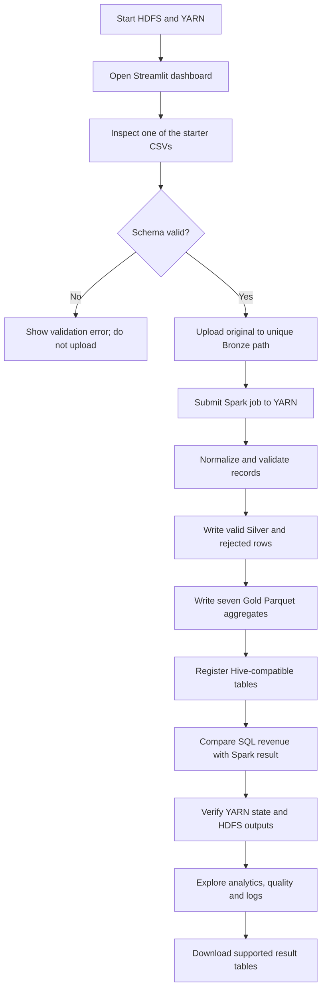

# User and pipeline workflow

For the faculty demonstration, use `data/raw/ecommerce_transactions_50000.csv`, run Pipeline Monitor, then visit Sales Analytics, Customer Analytics and Data Quality. Pipeline IDs, YARN application IDs, stages and output locations are recorded in `.runtime/logs/` and HDFS. Do not format HDFS during normal startup.
